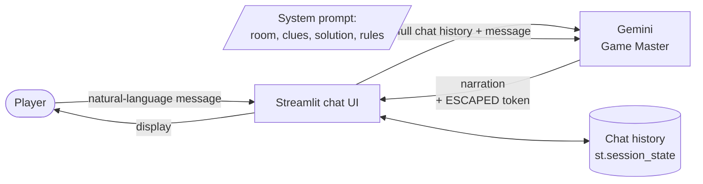
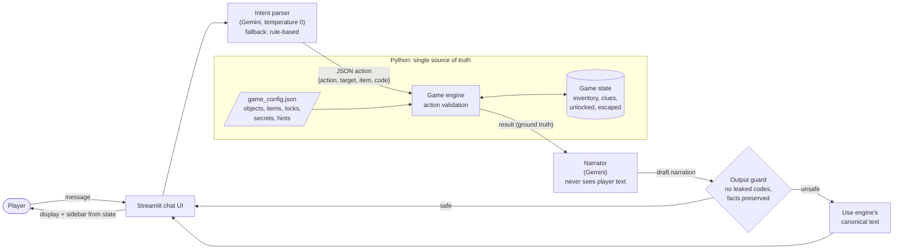

# Architecture

GitHub renders the Mermaid diagrams below automatically.

## Version 1: the LLM is the whole game

**Weakness:** the rules, the solution and the "memory" all live in text that the LLM can ignore, forget or leak.
The only game state is the chat history, and the only win check is a token the LLM chooses to emit.

## Version 2: Python decides, the LLM describes

## Key design decisions

| Concern | Decision |
|---|---|
| Who decides success? | `engine.py` only. LLM output never modifies the state. |
| Where are solutions stored? | `game_config.json`. They are never inserted into any prompt. |
| Prompt injection | The intent parser can only output a fixed JSON schema; authority claims and demands become `unknown`. The narrator never sees the player's raw message. |
| Hallucinated codes and objects | A code must literally appear in the player's text; objects must resolve to ids in the config. |
| Leaks | `leaks_secret()` blocks any narration containing an undiscovered code. |
| API down or no key | The rule-based parser and the engine's canonical text keep the game playable. |
